# Assets

Every asset, its state, and where to find it. The standard they're all judged by is the [art style](style/art-style.md). In Studio,
kits sit in `ServerStorage`, with shelves to copy from near x 30,000 (select a shelf's ShelfGround and press F).

| Asset | State | Notes |
|---|---|---|
| Houses (12) | In Studio. Design chosen ("dark warm stone"), no verdict on Studio colours | `ServerStorage.HouseKit`, [lesson](style/lessons/cottage.md) |
| Rose Cottage | Blender only, front designed; back and right side plain | [notes](../art/kit/rosecottage/README.md) |
| Cobble kit (edging, border stones, paving) | In Studio | [Cobble kit](style/cobble-kit.md) |
| Flower beds | In Studio, first pass | [Flower beds](style/flower-beds.md) |
| Rock pack (50) | In Studio | [Rock pack](style/rock-pack.md) |
| Stylized rock kit | Blender only | [Rock kit](style/rock-kit.md) |
| Trees and understory (21) | In Studio | [Forests](style/forests.md), [Foliage](style/foliage-method.md) |
| Fence | Approved | `ServerStorage.FenceKit` |
| Props (11) | Approved in Studio | `ServerStorage.PropsKit`, [lesson](style/lessons/props.md) |
| Stone bridge | In Studio, awaiting the user's OK | [lesson](style/lessons/bridge.md) |
| Wooden bridges (second set) | Blender only, no verdict | `art/kit/woodbridge_b` |
| Stone sword | In Studio; the user liked it | [Stone sword](style/stone-sword.md) |
| Hub blockout | In Studio, layout proposed | [The hub](lands/hub.md) |

## Pictures
**Houses**

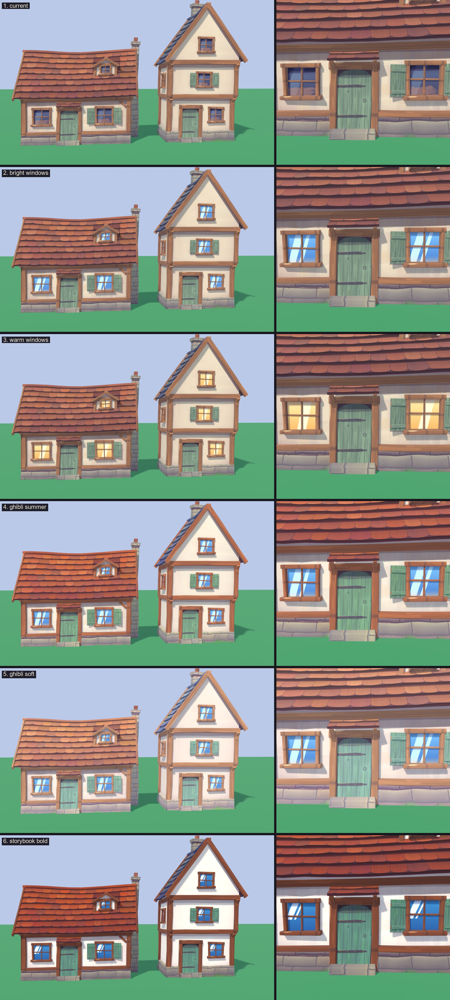

**Rose Cottage**

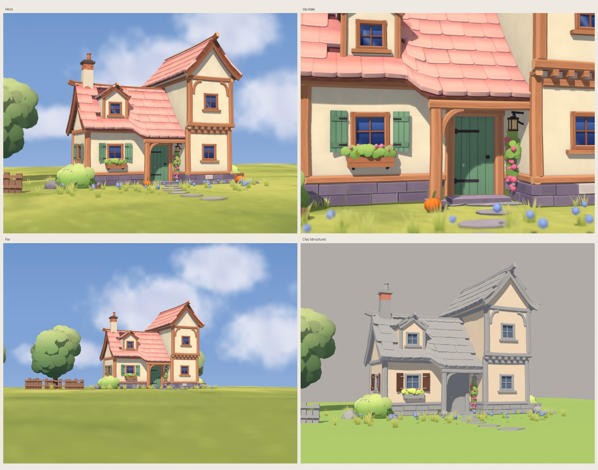

**Cobble kit**

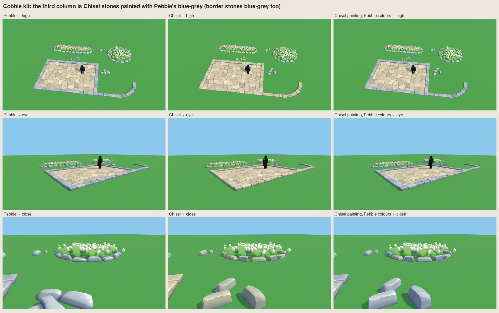

**Flower cards**

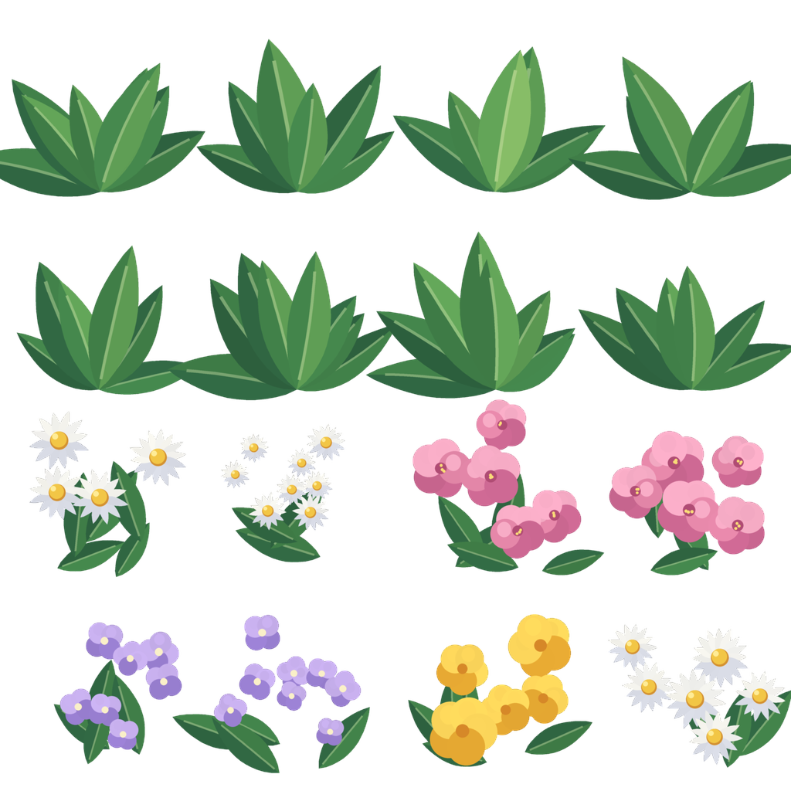

**Rock pack (moss)**

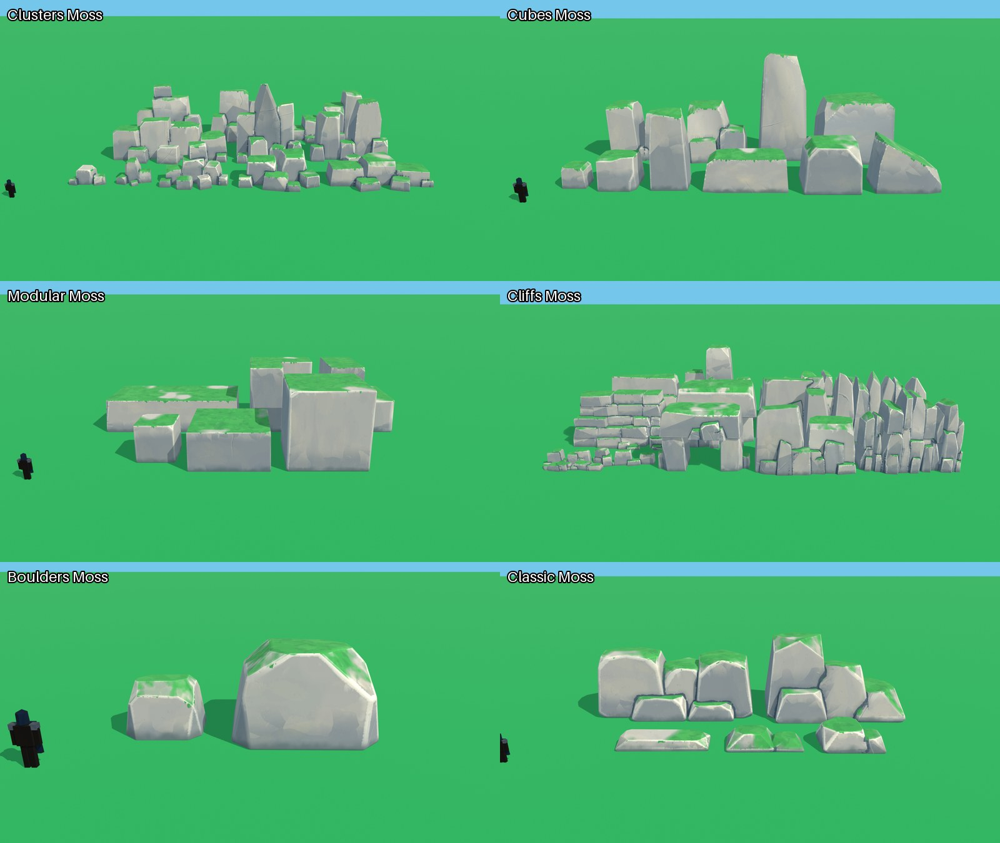

**Stylized rock kit**

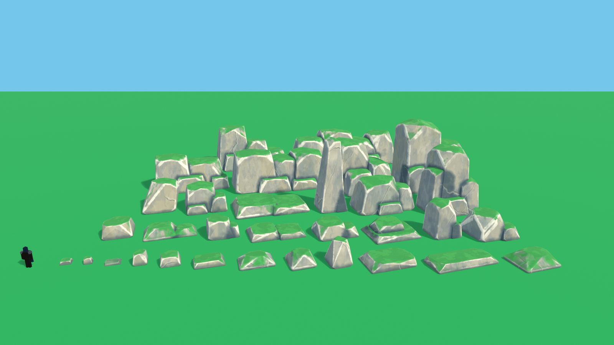

**Fence**

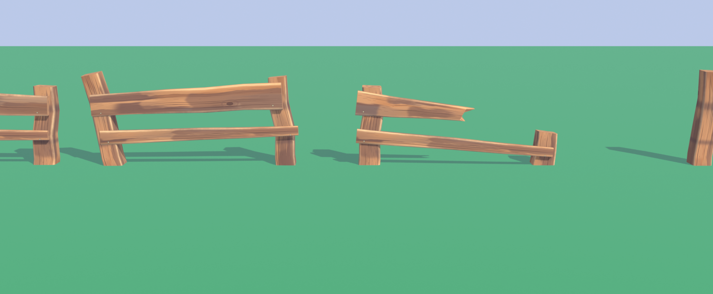

**Props in Studio**

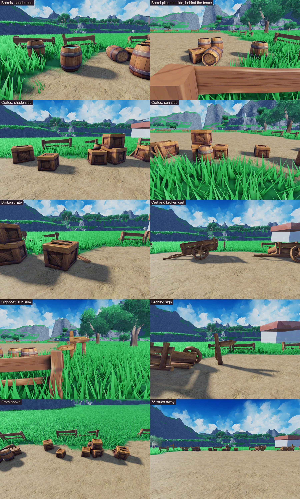

**Stone bridge in Studio**

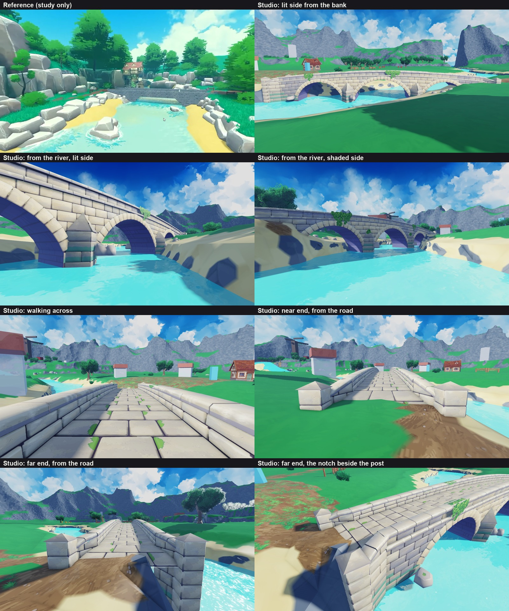

**Wooden bridges**

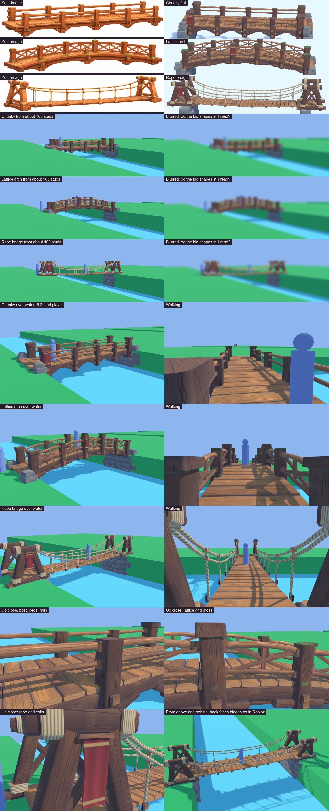

**Stone sword**

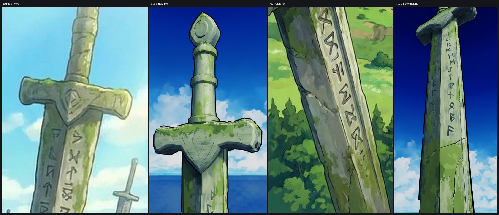

**The hub plan**

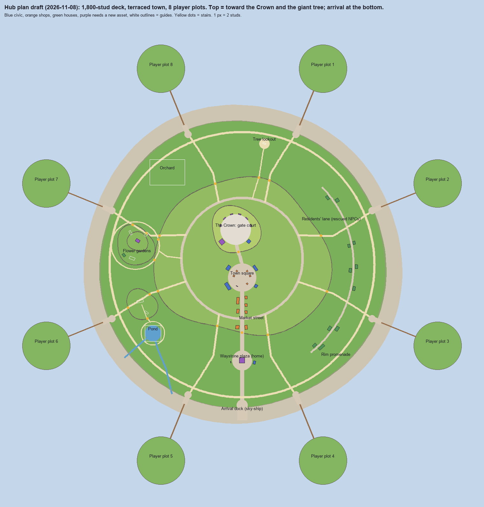

**Land 1 beauty passes**

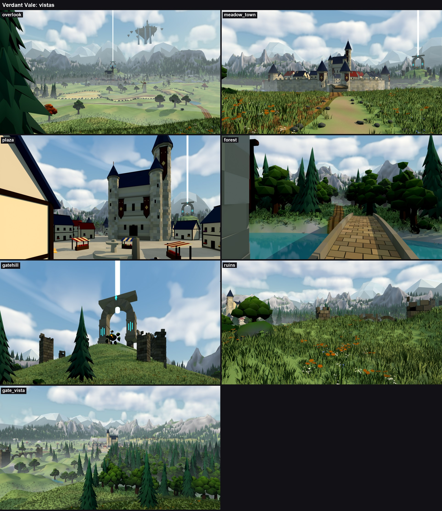
