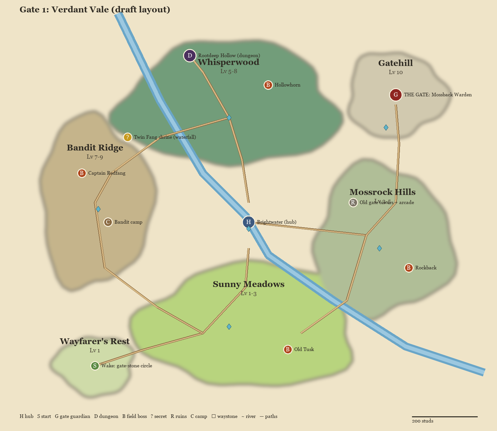

# Gate 1: Verdant Vale (draft v0.1, 2026-11-02)

The first Land. It teaches everything and has to sell the game in the first 10 minutes. The broad strokes come first;
details get their own passes later. Map: `art/lands/land1/map.png` (source data `map.json`, drawn by
`tools/art/land_map.py`).

**Renamed** from "Ashen Vale": the user's references for this Land are bright, lush anime meadows (painted blue sky, big
clouds, mossy boulders, dirt paths with flowers) and a glowing forest hollow. "Ashen" doesn't fit that.

## Look

- **Meadows**: bright saturated greens, a strong blue sky with big white cumulus, mossy-topped grey boulders, dirt
  paths with patches of grass in them, white and yellow flowers, round leafy trees mixed with our solid pines, blue
  mountains behind.
- **Whisperwood**: a darker teal-green forest with roots, vines and glowing white flowers, light shafts through
  openings, a cave mouth glowing at the far end.
- **Change from the copy**: the copy's palette (`look-rules.md`) is the muted AI screenshot. Verdant Vale pushes
  greens and sky saturation up and keeps the light, haze and scale rules. That needs a short look pass once there's
  terrain.
- **Trees**: the solid kit pines (the card-branch trees are parked). Round leafy trees in the same solid style still
  need making.

## Shape of the Land

About 1,400 x 1,200 studs, a rough ring around the hub. You always see where you're going: the **Gate on Gatehill**
(the arch and towers) is visible from the hub and from every zone. Zones go round clockwise, getting harder, and short
cuts link the far zones back to the hub so walking back never takes long. Target: from the hub to the edge of any zone
in under 60 s of running, plus waystones for fast travel.

| # | Place | Levels | What it is |
|---|---|---|---|
| 0 | **Wayfarer's Rest** | 1 | Where you wake: a dormant gate-stone circle on a cliff above the vale, 2 min of tutorial path down to the hub |
| H | **Brightwater** (hub) | safe | A castle town on a river island (see below) |
| 1 | **Sunny Meadows** | 1-3 | Open rolling fields south of the hub, the first reference image. Learn to fight, first drops |
| 2 | **Mossrock Hills** | 3-5 | Boulder fields and old ruins to the east: the gate towers and arcade from the style copy, moss golems |
| 3 | **Whisperwood** | 5-8 | Deep forest to the north, the second reference. Wolves, wisps, mushroom folk, a hidden shrine |
| 4 | **Bandit Ridge** | 7-9 | A ridge of old watchtowers to the west, taken over by bandits. A camp to clear |
| D | **Rootdeep Hollow** | 6-9 | The dungeon: a glowing cave under Whisperwood, 3 rooms and a boss, the best farming |
| G | **Gatehill** | 10 | The ring of ruined watchtowers around the Gate: the Guardian fight |

## Brightwater (the hub)

A small castle town on a river island, 7DS-pastoral: white walls, blue-slate roofs, flower boxes, a waterwheel, a
tavern with a big painted sign. Three bridges in (south to the Meadows, east to Mossrock, north to Whisperwood). The
castle keep is on the island's high end, so it's a landmark from every zone.

| Spot | What you do there |
|---|---|
| Castle keep, **Captain Aldric** | Main story NPC: the Gates, the Guardian, a quest at each milestone |
| **Market square** | Blacksmith (craft, upgrade, salvage), General store (potions), Alchemist (buffs later) |
| **The Sleeping Stag** tavern | Bounty board (3 daily bounties), rumours (hints at secrets), the social spot, music |
| **Training yard** | Dummies for every weapon type, mastery shown, a tutor NPC for new weapons |
| **Pet stable** | Hatch eggs, pick your follower, feed and evolve |
| **Fountain plaza** | Party meeting point, the hub's waystone, the "first Mythic" board (server records) |
| **Wardrobe** | Cosmetic overlay (keep your favourite armour look) |

## Enemies

Simple to read, one new idea each. Every enemy has a wind-up you can see before a big hit.

| Enemy | Zone | Behaviour (the one thing to learn) | Drops |
|---|---|---|---|
| **Slime** (green, blue) | Meadows | hops in, splits once when hit hard | Slime Gel |
| **Hornhare** | Meadows | fast, darts in and out: teaches timing | Soft Pelt |
| **Field Boar** | Meadows | telegraphed charge: teaches the dodge roll | Boar Hide, Tusk |
| **Moss Golem** (Lv.2 stone guard) | Mossrock | slow, heavy slam with a ground marker; weak glowing core in its back | Mossy Stone, Golem Core (rare) |
| **Bandit Scout** | Mossrock, Ridge | ranged slingshot, keeps distance: teaches closing in | Coin Pouch, Scrap Iron |
| **Thornwolf** | Whisperwood | packs of 3 that circle and take turns: teaches crowds | Wolf Pelt, Fang |
| **Wisp** | Whisperwood | floats, blinks away, glows before a zap | Wisp Dust |
| **Mushroom Folk** | Whisperwood | puffs a slowing spore cloud: stay out of the circle | Spore Cap |
| **Bandit Brute / Archer** | Bandit Ridge | the brute shields the archers: teaches picking targets | Scrap Iron, Bandit Badge |

**Field bosses** (wander, respawn every few minutes, a horn sounds when one spawns):

| Boss | Zone | Signature |
|---|---|---|
| **Old Tusk**, a giant boar | Meadows | charges in a line three times, then is stunned against a rock |
| **Rockback**, a big moss golem | Mossrock | boulders roll down a slope; hide behind ruins |
| **Hollowhorn**, a stag spirit | Whisperwood | vanishes into fog and charges from the glow; flowers show where |
| **Captain Redfang**, the bandit leader | Bandit Ridge | calls archers on the towers; knock the ladders down |

**Dungeon: Rootdeep Hollow.** Three rooms (a mushroom grove, a wolf den, a root bridge over a glowing pool), then
**the Rootmother**: a great tree-spirit. Roots burst out of the floor where the ground glows, and in phase 2 the pool
rises and only the root platforms are safe. A party of 1-4, about 6-8 minutes a run.

**Gate Guardian: the Mossback Warden** (Lv.10), in the ring of ruined watchtowers on Gatehill. Phase 1: slams and a
rolling charge. Phase 2: it tears the Gate's arch out of the ground and swings it, knocking towers down into ramps and
cover. Beat it, the Gate wakes, and Land 2 opens.

## Loot

| Source | What drops |
|---|---|
| Field enemies | Common/Uncommon weapons and armour of all 4 types, materials |
| Field bosses | Rare gear (one bonus stat), a guaranteed material bundle, a pet egg chance |
| Rootdeep Hollow | Epic gear, the **Rootguard** armour set pieces |
| Mossback Warden | Epic and **Legendary** (pity-protected), the **Wardenstone** set pieces |

- **Armour sets**:
  - **Meadowguard** (Uncommon, from the fields): 2-piece +5% move speed, 4-piece heal a little after each kill.
  - **Rootguard** (Epic, from the dungeon): 2-piece +poison resist, 4-piece thorns.
  - **Wardenstone** (Epic, from the Guardian): 2-piece +defence, 4-piece your dodge leaves a stone shield for 2 s.
- **Legendaries** (hand-made looks, unique effects):

  | Weapon | Source | Effect |
  |---|---|---|
  | **Mossbreaker** (greatsword) | Warden | every 4th hit cracks the ground in a line |
  | **Whisperfang** (dual blades) | Hollowhorn, rare | hits leave a wisp that strikes again |
  | **Tuskspear** (spear) | Old Tusk, rare | a charged thrust dashes you forward |
  | **Brightwater Oath** (sword & shield) | the last main-story quest | blocking a hit heals you |

- **Mythic** (the server-announced chase): **Dawnsplitter** (sword). A tiny chance from the Warden with long pity, or
  from the hidden "Sunrise on Gatehill" event. Its awakening quest is in Land 3.
- **Pets**:

  | Pet | Rarity | Where | Buff |
  |---|---|---|---|
  | Meadow Bunny | Common | Meadows | +gold |
  | Moss Pebble (a tiny golem) | Rare | Mossrock | +defence |
  | Wisp | Epic | Whisperwood, Rootdeep | auto-collects drops in a wide circle, +XP |

- **Materials** feed the blacksmith: gel, pelts, hide, mossy stone, wisp dust, scrap iron. Each upgrade step asks for
  a few from one zone, so every zone stays worth visiting.

## Quests

- **Main thread** (light story, told by NPCs):
  1. Wake at the Wayfarer's Rest.
  2. Reach Brightwater.
  3. Captain Aldric sends you to clear the Meadows; beat Old Tusk.
  4. Find out why golems guard the old towers (Mossrock).
  5. A lost scout in Whisperwood leads to Rootdeep Hollow; beat the Rootmother.
  6. Take the bandits' stolen Gate-key piece on the Ridge.
  7. Climb Gatehill; beat the Mossback Warden; the Gate opens.
- **Side quests**: 2-3 per zone, each paying something real (a pet egg, a weapon, a set piece).
- **Daily**: 3 tavern bounties ("30 Thornwolves", "Old Tusk once", "a Rootdeep clear").

## Secrets

- **Twin Fang shrine** (the hidden skill): behind a waterfall in Whisperwood. It needs mastery 10 in two weapon types,
  and the tavern rumour hints at it.
- **Rune stones**: 5 hidden in the Vale; read all 5 for a permanent stat bonus and a title.
- **Chests** in hard-to-reach spots: tower tops, a cave above the river, the island under the hub's bridge.
- **The Sunrise event**: once a real-time hour the sun rises over Gatehill and a golden golem walks the hills
  (Mythic chance).

## First 10 minutes (the hook)

1. Wake at the stone circle; the camera pans to the far Gate with the Warden asleep in it.
2. Walk down: 2 slimes (attack), a boar (dodge), a scripted Rare sword drop at about minute 3.
3. Reach Brightwater: the market, a free pet egg (Meadow Bunny), the bounty board.
4. Out into the Meadows, level 3-4 by minute 10, first weapon skill unlocked, Old Tusk's horn sounds in the distance.

## What's next after this

- A grey-box of the whole Land in Blender (heights, paths, the hub's footprint) to check distances and sightlines.
- Weapon style (the user's next topic), then enemy and hub models, then look passes on each zone.

## Block-out v1 (2026-11-02)

Grey-box of the whole Land: `tools/blender/land_blockout.py -- art/lands/land1/map.json` (the heights and dressing
are in map.json's `Blockout`).
- **Renders** in `art/lands/land1/blockout/`: `aerial_labelled.png`, `top.png`, `eye_sheet.jpg` (start overlook, hub
  to gate, meadows to gate, Whisperwood), `blockout.blend`.
- **Walking times** in `travel.json`.

What it showed and what changed:
- **Walking times**: every key place is 26-52 s from the hub at Roblox's walk speed (16 studs/s, paths ~1.3x the straight
  line). That's under the 60 s target. The longest are the start circle (52 s) and the Gate (48 s, a 45-stud climb).
- **Empty gaps** between the zones: the zones were grown to fill the Vale, and the grassland between them gets sparse
  trees.
- **The Gate wasn't visible** from the hub or the meadows, hidden by the Mossrock hills. Gatehill was raised to 75 studs
  and the Gate's towers to 30/38. It now shows from the hub and, small, from the meadows. It should be bigger or lit
  (a glow or a beacon) when it's made properly.
- **The keep** was raised to 60 plus a spire. It's now the landmark seen from the meadows and the start.
- **The start overlook works**: the whole Vale, the town and the Gate in one view. The wake circle keeps a 60-stud clear
  view.
- Still rough:
  - Whisperwood's eye view starts inside a tree.
  - Wayfarer's Rest plateau reads as a rim, not a cliff edge.
  - Paths cross the river without bridges yet.
  - Mossrock's hills need shaping around the ruins.

## Beauty pass (2026-11-03)

`tools/blender/vale_beauty.py -- art/lands/land1/map.json <out> [--views a,b] [--quick] [--grass <style>]` dresses the
block-out in the target look. All its settings are in map.json's `Beauty` block. Hero views are in
`art/lands/land1/beauty/v0N/` (post: `tools/art/look_post.py <view dir> art/lands/land1/map.json --key Beauty`); the
look rules are in `docs/style/look-direction.md`.

Changes to the Land itself:
- **The river splits around Brightwater.** It used to run straight across the town island, with houses standing in it.
  It now flows into the moat on one side and out on the other (`land_blockout.river_dist`).
- **The ring of mountains** is now natural ranges (`Blockout.RimStyle: natural`, `rim_mountains`): crests, saddles,
  gullies, high sections and low passes, and foothills just inside the edge. The old ring was regular waves.
- **Farmland:** strip fields around the windmill and along the river south-east of town, with hedgerows (`Beauty.Fields`).
  This is the countryside around a castle town, and it gives the overlook its patchwork.
- **A floating island** hangs over the eastern mountains, seen from the start overlook: a forested top, a ruined keep,
  waterfalls, small islets around it. It is the far promise of later Lands.

Hero views: overlook (the start circle's edge, the town with the Gate's beam behind), meadow_town (the south road),
plaza, forest (the road into Whisperwood), gatehill, ruins, gate_vista (from the Gate back over the whole Vale).

### At the player's feet (2026-11-03, second round)

The user's review: grand from a distance, but it fell apart close up. Changes, all judged from six walk views with a
5.2-stud player (`walk_*`; rules in `docs/style/ground.md`):
- **Paths:** real trails with crisp edges, wheel ruts and edge stones. Lanes (paths 3-5) are narrower with a grassy
  crown. A signpost stands at each junction.
- **Grass:** matched to the ground. Nothing grows on trails; the verges are worn; clumps grow at the feet of rocks,
  trees and walls.
- **Ground:** detail textures keep it crisp up close.
- **Fields:** wheat and leafy crop rows.
- **Woods:** faceted trees kept about 9 studs off the paths, ferns under the trees.
- **Bridges:** paved decks.
- **Navigation research** (Elden Ring and others): the Gate is the Vale's Erdtree; lures go off the road; road
  hierarchy; a camera that pitches up on climbs.

## Vale v2: 20x the area (Proposed 2026-11-05)

The user judged the 1,400 x 1,200 grey-box too small and too boring, and chose 20x the area: 6,260 x 5,370 studs, 6.6 minutes to walk across. Spec: `art/lands/land1_v2/spec.json`. Generator: `tools/art/land_v2.py` (terrain tiles, objects, `plan.png`, clay `views.jpg`, `report.json`). Studio builder: `tools/studio/build_land_v2.luau` (world position = map + (4000, 0, -3000)).

Layout changes, all open to review:
- **The story now runs as one arc** from the Wake crag in the south-west: Meadows (south), Mossrock (west), Whisperwood (north), Bandit Ridge (east), Gatehill (north-east). Bandits sit next to the Gate, so the last walk no longer goes back through low-level land, and new players don't start beside Lv 7-9.
- **Levels:** Whisperwood 5-7, Gatehill 9-10, so level 9 is covered without leaning on the dungeon. The east road from the hub is meant to stay locked until story step 6 (a label only in the grey-box; it isn't blocked).
- **Brightwater** sits on an island in a lake, with four road approaches (three bridges in the first map).
- **New landmarks:** the Fallen Colossus (Mossrock's hills are a giant lying down, an older Warden, so the golems guard its body), the Elder above Rootdeep, a cliff and waterfall under Whisperwood, Redfang Cut through the ridge, a spiral Warden's Stair and a 200-stud Gate with a light beam.
- **Enemy density:** 353 camps of 4, gathered in patches, not spread evenly as a straight 20x would be (about 1,260).

Assumptions to test: terrain and block streaming at this size, whether the Gate and keep show across the map in play, and whether Studio holds up on the user's PC.

## Vale v3: the star blockout (Proposed 2026-11-06)

Same 6,260 x 5,370 ground as v2, rebuilt for `docs/game-design.md` section 14. Spec `art/lands/land1_v3/spec.json`; run `python tools/art/land_v2.py art/lands/land1_v3/spec.json`, upload the tiles and `objects.png` (`tools/roblox/upload_asset.py --image`), update the DATA block in `tools/studio/build_land_v3.luau`, run it in Studio. It replaces `Workspace.ValeV2` with `Workspace.ValeV3`.

- **Home plot** off the Land's east side (map 7400, 2700): Gate Court with four arches (Verdant Vale open, three locked), nine building plots, spawn at a campfire.
- **`Content`:** 25 farming spots, 6 materials, 8 rescues, 6 field bosses (the Warden is the Guardian), 6 secrets, 1 dungeon, 5 locks. All markers; no enemies or systems are live.
- **Progression, checked by a flood from the start** (`reachability`: uphill onto a surface steeper than 52 degrees is blocked, `report.json`, `reach_<n>.png`): 46.7% of the map with every lock shut, 84.3% after Mossgate, 93.0% after Stair Gate. No item is reachable earlier or later than the spec says. The South mesa cache is climb-only on purpose.
- **Walls** (`wall` forms) are rough straight cliff bands, there to prove the structure; they need shaping into the land. Locks are see-through markers you can walk through, so a tester isn't stuck; in the flood they count as shut.
- `BlockoutTravel` script (grey-box only): Gate Court prompts, Go home on every waystone, `MaxSlopeAngle` 52, test mount at 60 studs/s on the Stable plot.

Known leftovers: walking stretches of 58-92 s with nothing nearby on six roads (East lane 92 s, Colossus lane 78 s), secrets' movement requirements are labels only, and rescues don't do anything yet.
