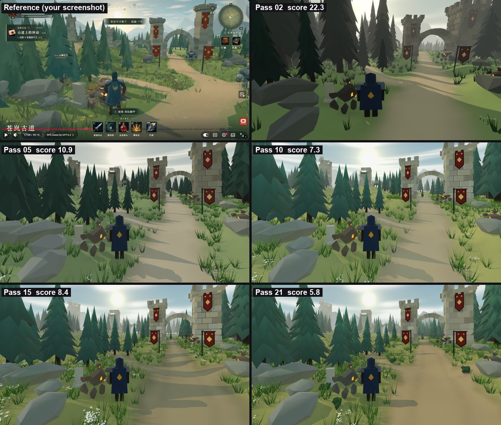

# Look rules (from the reference copy, 2026-11-02)

What 21 passes of copying the reference screenshot taught us, written as numbers to build further terrains with. The
source of every value is `art/look/ashen_ref/scene.json` (the spec of the latest pass). The pass history and tools are
in [look-passes.md](look-passes.md). Values marked "Blender" are for the copy's renderer; the Roblox column is a first
guess to check in Studio.

## 1. Camera and composition

- **The reference camera is level, with the horizon high in the frame** (row 262 of 752, about 35% from the top) and
  vertical edges perfectly upright. That's a lens shift, which Roblox cameras can't do. In Roblox we get a similar
  frame by pitching down about 10-12° at FovV 70, and verticals will lean a little at the edges.
- Third-person distance: camera 8 studs up, about 12 studs behind the player, player centred, feet near the bottom
  fifth of the frame.
- Composition: a big dark tree mass framing one side, the **landmark (gate) a third in from the other side**, the road
  leading the eye from the bottom of the frame to the landmark, secondary landmarks (ruined tower, arcade) half hidden
  in the middle distance, mountains behind everything, the sun in the sky above the gap between them.

## 2. Scale (studs; a player is 5.2)

| Thing | Size | vs player |
|---|---|---|
| Gate towers | 19.5 and 24 tall, 7-8.3 wide (a big and a small one) | 4-5x |
| Arch opening | 11 wide, crown 17 above the road | 2x wide |
| Banner poles | 9.5 tall, banners about 3 x 7 | 2x |
| Pines | 20-40 tall, skirts 0.37 x height across | 4-8x |
| Boulders | 3-9 across | |
| Stele | 3 tall | 0.6x |
| Golems (Lv.2) | 4-6 tall | ~1x |
| Road | 4.5-6 wide at the gate, 9-12 near junctions | |
| Gate rise | the gate stands 3-5 above the approach | |

## 3. Light

- **Sun from the side**: from the left, almost square to the view (85° from the camera's forward direction),
  45° up. Warm `#ffe8c2`. Blender strength 2.4.
- **The painted sun is not the light.** It sits ahead in the sky (row 77) for the backlit glow, while the light comes
  from the side so the faces facing the camera stay readable. Front-lit or truly backlit both scored worse.
- **Ambient = the sky's light with a warm-neutral tint** (`#fff4ea`, Blender strength 1.85). The tint cancels the
  sky's cyan: without it every shadow went green-blue.
- Soft shadows (sun angle 6°). Shadows are mid-tone, never black.

## 4. Sky

- Gradient by elevation: `#c8d2cc` (-2°), `#cdd8d6` (3°), `#accacf` (10°), `#90b6c3` (18°), `#7aa5bf` (28°), `#6693b2`
  (50°), `#5d8cae` (90°). A pale, slightly cyan teal, never saturated blue.
- Sun: small hot disc (1.3°) with three glows: 3° bright, 8° soft, 35° faint, all warm cream (`#ffe9b8`, `#f7e5bb`,
  `#efe1bf`). A warm side tint within 45° of the sun.
- Clouds: about 60 soft puffs between 8° and 40° up, white with light bellies (`#dde4e4`), thinning toward the horizon.
- Tool: `tools/art/sky_paint.py` paints it as an equirect image (Blender world now; Roblox skybox faces later).

## 5. Haze (Roblox: Atmosphere)

- **Clear for the first 100 studs, then builds**: Gaussian falloff `1 - exp(-((d - 40) / 260)^2)`, capped at 65%. So
  ~5% at 100 studs, ~20% at 170, ~50% at 300, mountains at the cap. Plain exponential fog greyed out the woods behind
  the gate and was dropped.
- Colour `#d2d8d0`, warming toward the sun (`#efe8d2`).

## 6. Post (Roblox: Bloom, ColorCorrection)

- Bloom: only the sun and sky blow out (threshold 1.0, intensity 0.35).
- Contrast -0.06. **No global saturation change and no global tint.** A warm overall tint (pass 6) yellowed the sky,
  stone and mountains; the warmth belongs in the grass, road and sunlight only.

## 7. Palette (albedo, sRGB)

| Material | Colour | Notes |
|---|---|---|
| Grass | `#898646` / `#757b42`, dark clumps `#5c6137`, sunny patches `#999652` | olive, yellow-leaning; reads green in shade |
| Road | `#96825d`, rim `#796c46` | warm tan, darker 1-stud rim, faint ruts |
| Pine | `#7ea495`, underside `#5b7e72`, bark `#4a382c` | muted teal, not emerald |
| Stone (towers) | `#cccac2` / `#b6b4ac` | neutral grey, one tone per block |
| Rock | `#b3b7b0` / `#9ca19c` | cool grey |
| Banner | `#9f2c1d`, edge `#63170e`, emblem `#e2cfa0` | brick red, cream diamond |
| Wood | `#4b3628` | |
| Mountains | `#7f90a3` | under heavy haze |
| Grass blades | `#62903f` to tips `#b0c870` | |
| Flowers | white `#f2f0e6`, yellow `#e9c13c` | |

## 8. Terrain

- **Never flat.** The approach sits in a shallow dip; the landmark stands on a broad rise (+3 to +5); the land keeps
  climbing gently behind it (+0.06 per stud); mounds sit in the forks between roads; banks follow roads.
- Roads are sunk 0.4-0.5 with a 4-5 stud bank, a soft wobbly edge (1 stud) and a darker 1.1-stud rim. They're wide
  where they meet and narrow at gates. Widths are set per point.
- Grass is three tones in patches about 16 studs across, plus a 6% fine grain. Painted occlusion darkens the ground at
  the feet of trees, rocks and walls.

## 9. Scatter

| Layer | Density (per sq stud) | Where |
|---|---|---|
| Tall tufts (fine blades, ~1.9 tall) | 0.45 | within 2.2 studs of road edges, around rocks and trees |
| Tall tufts | 0.05 | open grass |
| Short grass (0.8 tall) | 0.35 | everywhere within 70 studs (ground texture) |
| White flower clusters | 0.25 edges, 0.04 open | |
| Yellow daisies | 0.025 | in patches near the camera |

Trees: **place landmark trees one by one and keep sky gaps.** A forest fill in the middle distance (pass 13) walled off
the sun and the ruins. Fills only for far bands and the woods behind landmarks, with an open sunlit meadow in front
of them.

## 10. Models (`tools/blender/kit.py`)

- **Pines**: 8-10 tiers of drooping skirts. Each rim has 11 ragged spikes with notches between them, a dark underside
  cone, **smooth shading**, a darker rim fading to a lighter top on each tier, and a slight lean. 370-460 triangles.
  Flat-shaded pines looked too faceted and dark (pass 8).
- **Rocks**: rounded hulls (34 points, merged to big facets), smooth shading with creases over 38° kept hard. 50-60
  triangles.
- **Towers**: big blocks in courses with interlocked corners, a 4% chamfer (more read as bricks), a corbel band and
  three chunky merlons per side. About 1,500 triangles.
- **Banners**: chevron tip, dark edge, cream diamond and two marks, on tower faces or L-shaped poles.
- **Grass blades**: 0.02-0.04 wide. Thick blades read as agave plants.
- Characters (hero, golem) are stand-ins only.

## 11. Roblox translation (to verify in Studio)

| Copy | Roblox |
|---|---|
| Sun from the side, 45° up | Lighting.ClockTime + GeographicLatitude, and turn the map so the sun is on the left of the main sightlines |
| Sun 2.4 warm | Lighting.Brightness ~2-3, sun colour from the sky preset |
| Ambient 1.85 warm-neutral | OutdoorAmbient ~`#9a9a90`, Ambient ~`#5a5a55`, EnvironmentDiffuseScale 0.5 with the painted skybox |
| Haze | Atmosphere: Density ~0.3, Offset ~0.1, Color `#d2d8d0`, Decay `#ffe9b8`, Glare 0.3, Haze 1-2 |
| Bloom | BloomEffect Intensity 0.35, Threshold 1, Size 24 |
| Grade | ColorCorrectionEffect Contrast -0.06 |
| Vertex-coloured kit | MeshParts, SmoothPlastic, Color white, imported vertex colours; grass/banners DoubleSided |
| Terrain mesh with vertex colours | 1-stud vertex-coloured mesh chunks (64 x 64 studs = 8k triangles), or Roblox Terrain with matched MaterialVariants |

## 12. Not matched yet

- The reference's ground has a painterly softness (partly video compression). Ours is crisper (detail 0.80 vs 0.73 in
  the ground band).
- Our middle distance has a bit more contrast than the reference (spread 13.8 vs 10.9).
- The tower shadow falls on the road through the arch; the reference's road there is sunlit.
- The mountains show a little less than in the reference.
- Hero and golems are placeholders.

## 13. Card-branch trees (test, 2026-11-02)

`tools/blender/card_trees.py`, textures by `tools/art/foliage_textures.py` (`art/kit/textures`). The trunk is a real mesh;
the foliage is flat cards with painted cut-out textures, with normals bent outward from the crown so it shades as one
soft shape.
- Spruce: whorls of 3 crossed cards per branch, lower branches droop, 564 triangles.
- Leafy tree: limbs ending in clusters of leaf cards facing every way, 218 triangles. There's a green and an autumn
  version.

Test renders: `art/look/grove/r02/final.png` (a grove) and pass `c01` (card pines in the reference copy). With card
pines the middle band's brightness and contrast match the reference better (L 40.4 / spread 11.6 vs 40.0 / 10.9), but
the image is much busier (detail 1.83 vs 0.99) and reads more realistic than the reference's stylised cones. A forest
should mix species and include young trees, snags and the odd autumn tree.

For Roblox each tree splits into `<Name>_Trunk.glb` (collides) and `<Name>_Crown.glb` (a SurfaceAppearance with
transparent cut-outs, no collision, ignored by the camera). Not yet tested in Studio: cut-out shadows, overdraw on
phones. The Blender render of the reference copy took 80 s instead of 20 s, so cut-outs cost something; budget for it.
